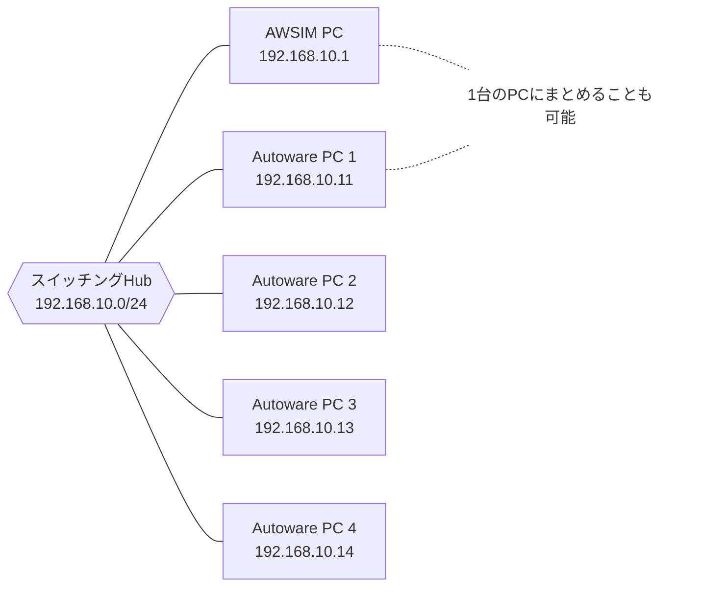
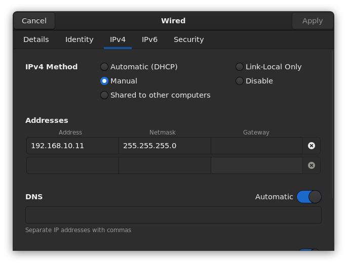

# Multiplay（LAN内複数PC構成）

`make dev4` コマンドを使用すると、1台のPC上でAWSIMと4つのAutowareを起動し、複数台走行を実現できます。しかし、この方法には「PCへの負荷が非常に高い」「すべての車両が同じAutowareのソースコードで動いてしまう」といった課題があります。

複数のPCを同じネットワークに接続し、各PCでAutowareを個別に実行することで、これらの課題を解決できます。これにより、異なるソースコードを用いた複数チーム間での対戦走行が可能になります。また、処理負荷を分散できるほか、Autowareのみを実行するPCではAWSIMを起動する必要がないため、比較的スペックの低いPCでも参加できるようになります。

なお、シミュレーション決勝のシステム構成は、本ページに記載されている方法を採用しています。



## 必要なもの

- ネットワーク接続できるPC（LANケーブルまたはWi-Fi） × 1〜5台
- ルーターまたはスイッチングハブ × 1台

## 構成

AWSIMは専用のPCで動かすこともできますし、いずれかのAutoware用PC上で一緒に動かすこともできます。以下に2パターンの構成例を記載します。

- Autoware PCは4台分記載していますが、1台〜4台の任意の台数で動かすことができます。
- IPアドレスの設定は、スイッチングハブを使用する場合のみ必要です。ルーター（DHCP機能付き）を使用する場合は不要です。
- 記載しているIPアドレスの数値は一例です。必ずしも同じ数値を使用する必要はありません。また、他のネットワークインターフェースの設定と競合している場合は、別の設定を行ってください。
- 記載しているROS_DOMAIN_IDの数値も一例になります。1〜4で競合しない数値であれば、IPアドレスとの組み合わせに制限はありません。ただし、2台走行の場合は1〜2まで、3台走行の場合は1〜3までが使用できる数値です。

### 構成パターン1：AWSIMを専用PCで実行する場合の例

| PC名 | 説明 | IPアドレス（スイッチングハブ使用時） | `ROS_DOMAIN_ID` |
| :--- | :--- | :--- | :--- |
| AWSIM PC | AWSIM実行用PC | 192.168.10.1 | - |
| Autoware PC 1 | Autoware実行用PC | 192.168.10.11 | 1 |
| Autoware PC 2 | Autoware実行用PC | 192.168.10.12 | 2 |
| Autoware PC 3 | Autoware実行用PC | 192.168.10.13 | 3 |
| Autoware PC 4 | Autoware実行用PC | 192.168.10.14 | 4 |

### 構成パターン2：AWSIMとAutowareを同じPCで実行する場合の例

| PC名 | 説明 | IPアドレス（スイッチングハブ使用時） | `ROS_DOMAIN_ID` |
| :--- | :--- | :--- | :--- |
| Autoware PC 1 | Autoware + AWSIM実行用PC | 192.168.10.11 | 1 |
| Autoware PC 2 | Autoware実行用PC | 192.168.10.12 | 2 |
| Autoware PC 3 | Autoware実行用PC | 192.168.10.13 | 3 |
| Autoware PC 4 | Autoware実行用PC | 192.168.10.14 | 4 |

## 手順

### 1. ホストPCのROS 2設定を無効にする

AutowareやAWSIMを実行する際は、Dockerコンテナ内部のROS 2およびCycloneDDSを使用します。ホストPC側でROS 2やCycloneDDSの設定が有効になっていると通信が阻害される可能性があるため、無効化します。

- ホストPCの `~/.bashrc` などでROS 2関連の環境変数を設定していたり、読み込んでいる場合は無効にします（該当する行の先頭に `#` を付けてコメントアウトしてください）。
    - `ROS_DOMAIN_ID`
    - `ROS_LOCALHOST_ONLY`
    - `RMW_IMPLEMENTATION`
    - `CYCLONEDDS_URI`
    - `/opt/ros/humble/setup.bash`
- 変更を反映させるためターミナルを再起動し、以下のコマンドを実行して**何も表示されないこと**を確認します。

```bash
echo $ROS_DOMAIN_ID
```

### 2. 全PCを同じネットワークに接続する

#### ルーターに接続している場合（Ubuntuの場合）

以下の手順でDHCPを有効にします。（通常はデフォルトでDHCPに設定されているため作業不要です）

1. **Settings** → **Network** を開きます。
2. `<ルーターに接続しているネットワーク名>` の歯車アイコンをクリックし、**IPv4** タブを選択します。
3. 各項目を以下のように設定して適用します。
   - **IPv4 Method**: `Automatic (DHCP)`
   - **DNS**: `Automatic`
   - **Routes**: `Automatic`

#### スイッチングハブに接続している場合（Ubuntuの場合）

以下の手順で固定IPアドレスを設定します。

1. **Settings** → **Network** を開きます。
2. `<スイッチングハブに接続しているネットワーク名>` の歯車アイコンをクリックし、**IPv4** タブを選択します。
3. 各項目を以下のように設定して適用します（IPアドレスの末尾は「構成」の表を参考に、PCごとに重複しない値を設定してください）。
   - **IPv4 Method**: `Manual`
   - **Address**: `192.168.10.ooo`
   - **Netmask**: `255.255.255.0`
   - **Gateway**: 空欄のまま



#### ルーターに接続している場合（Windowsの場合）

以下の手順でDHCPを有効にします。（通常はデフォルトでDHCPに設定されているため作業不要です）

1. **Windowsスタートボタン** → **設定** → **ネットワークとインターネット** を開きます。
2. `IP割当:` の **編集** をクリックします。
3. IP 設定の編集を以下のように設定して適用します。
   - `自動 (DHCP)`

#### スイッチングハブに接続している場合（Windowsの場合）

以下の手順で固定IPアドレスを設定します。

1. **Windowsスタートボタン** → **設定** → **ネットワークとインターネット** を開きます。
2. `IP割当:` の **編集** をクリックします。
3. IP 設定の編集を以下のように設定して適用します。（IPアドレスの末尾は「構成」の表を参考に、PCごとに重複しない値を設定してください）。
   - `手動`
   - **IPv4：**: `オン`
   - **IP アドレス**: `192.168.10.ooo`
   - **サブネットマスク**: `255.255.255.0`
   - **ゲートウェイ**: 空欄のまま

※いずれの場合でも、設定が完了したら一度LANケーブルを抜き差しして設定が即時に反映させることを推奨します。（ケーブルを抜く → 5秒待つ → ケーブルを再度刺す）

### 2.5. WSL２のネットワーク設定を行う（Windowsの場合のみ）

- WSL2がWindowsホストと同じLAN上のIPアドレスを共有するように、ミラーモードに設定します。
    - Windows側で `.wslconfig` を開き以下を追記します
    - その後、WSL2を再起動します （Windows PowerShell上で `wsl --shutdown`）
    - 再起動後、WSL2上で `ip a` コマンドを入力します。ネットワークに接続されているインターフェイスのIPアドレスが `192.ooo.ooo.ooo` になっていることを確認します。 `172.ooo.ooo.ooo` だとミラーモードになっていません。設定の再確認とWSL2の再起動を試してください。

```txt
[WSL2]
networkingmode=mirrored
```

- 次に、WSL2専用のファイアウォール機能を有効にしたうえで、外部からのアクセスをすべて許可します。
    - Windows側で、**管理者権限で**Windows PowerShellを開き、以下のコマンドを実行します。
    - Nameは変更不要です。下記の文字列のまま入力してください。

```bash
Set-NetFirewallHyperVVMSetting `
    -Name '{40E0AC32-46A5-438A-A0B2-2B479E8F2E90}' `
    -DefaultInboundAction Allow `
    -Enabled True

# 元に戻す場合
Set-NetFirewallHyperVVMSetting `
    -Name '{40E0AC32-46A5-438A-A0B2-2B479E8F2E90}' `
    -DefaultInboundAction NotConfigured `
    -Enabled NotConfigured
# 設定確認
Get-NetFirewallHyperVVMSetting -Name '{40E0AC32-46A5-438A-A0B2-2B479E8F2E90}'
```

### 3. IP接続の確認を行う

他のPCとのネットワーク接続が正常に行われているか確認します。

- まず、通信相手となる他のPCのIPアドレスを特定します。
  - **スイッチングハブ使用時**: 前項で手動設定したアドレス（例: `192.168.10.1` , `192.168.10.11` 〜 `192.168.10.14`）になります。
  - **ルーター使用時**: 自動で割り当てられるため、各PCのターミナルで `ip a` コマンドを実行し、現在割り当てられているIPアドレスを確認してください。

- 相手のIPアドレスが確認できたら、以下のコマンドを実行して接続（疎通）確認を行います（`192.168.10.ooo` の部分は、確認した相手のIPアドレスに置き換えてください）。

    ```bash
    ping 192.168.10.ooo
    ```

正常に通信できていれば、応答（応答時間などの情報）が連続して表示されます（`Ctrl + C` で終了します）。

### 3.5. IP接続の確認を行う (Windowsの場合)

Windowsの場合、WSL2上のプログラムと他のPCが接続できていることを確認する必要があります。そのために、適当なhttpサーバーを立てて確認します。

1. まず、WSL2上で下記コマンドでhttpサーバーを立てます
    - `python3 -m http.server 8080 --bind 0.0.0.0`
2. 次に、他のPC上でブラウザを開いて `http://192.168.ooo.ooo:8080` へアクセスします。IPアドレスはWSL2上で確認したものになります。ブラウザ上にファイル一覧が表示されたら成功です。

### 4. CycloneDDSの設定を行う

Autowareでは、通信ミドルウェアとしてCycloneDDSを使用しています。Dockerコンテナ内のCycloneDDSが、ルーター（またはスイッチングハブ）に接続されたネットワークインターフェースを正しく使用できるよう設定を行います。

- まず、`ip a` コマンドを実行して、ルーター（またはスイッチングハブ）に接続されているネットワークインターフェース名を確認します。LANポートが複数ある場合は、ケーブルを抜き差しして状態が `UP` になるインターフェースを探すと特定しやすくなります。
  - 以下の出力例では、`enx607` が該当します。

```console
1: lo: 略
    略
2: docker0: 略
    略
3: enx607: <BROADCAST,MULTICAST,UP,LOWER_UP> 略
    略

```

- 次に、以下のコマンドを実行してCycloneDDSの設定を行います（`enx607` の部分は、上記で確認したご自身のインターフェース名に書き換えてください）。

```bash
IF_LOCAL=enx607    # 確認したネットワークインターフェース名に変更してください
cd ~/aichallenge-racingkart/
./setup.bash network if $IF_LOCAL
```

### 5. ROS 2ドメインIDの設定を行う

以下のコマンドで設定ファイル（`.env`）を開き、出走位置に応じて、`ROS_DOMAIN_ID` を `1`〜`4` のいずれかに設定します。出走位置と `ROS_DOMAIN_ID` の対応は、上記「構成」の表を参照してください。

```bash
code ~/aichallenge-racingkart/.env
```

```bash
# 出走位置に応じて設定する（使用するIDのみコメントアウトを解除）
ROS_DOMAIN_ID=1
#ROS_DOMAIN_ID=2
#ROS_DOMAIN_ID=3
#ROS_DOMAIN_ID=4
```

### 6. ROS 2接続の確認を行う

各PC間でROS 2の通信が正しく行われ、かつ `ROS_DOMAIN_ID` ごとに通信が分離されていることを確認します。

- まず、いずれかのPC（送信側）でテスト用のトピックを送信（publish）します。ターミナルを4つ開き、それぞれのコンテナ内で `ROS_DOMAIN_ID` を `1`〜`4` に指定して実行してください。

```bash
# ターミナル1（ROS_DOMAIN_ID=1 のトピックを送信）
cd ~/aichallenge-racingkart/
make autoware-bash
ROS_DOMAIN_ID=1 ros2 topic pub -r 1 /chatter1 std_msgs/msg/String "data: 'Hello World 1'"

# ターミナル2〜4でも同様に make autoware-bash を実行した上で、それぞれ以下を実行
ROS_DOMAIN_ID=2 ros2 topic pub -r 1 /chatter2 std_msgs/msg/String "data: 'Hello World 2'"
ROS_DOMAIN_ID=3 ros2 topic pub -r 1 /chatter3 std_msgs/msg/String "data: 'Hello World 3'"
ROS_DOMAIN_ID=4 ros2 topic pub -r 1 /chatter4 std_msgs/msg/String "data: 'Hello World 4'"
```

- 次に、接続確認を行う各PC（受信側）で、`ROS_DOMAIN_ID` の設定が正しいことと、トピックが受信できることを確認します。

```bash
cd ~/aichallenge-racingkart/
make autoware-bash
echo $ROS_DOMAIN_ID
ros2 topic list
```

- もしもうまく行かない場合、ROS 2デーモンの再起動を試してください。特にWindowsの場合は必須かもしれません。

```bash
cd ~/aichallenge-racingkart/
make autoware-bash
ros2 daemon stop    # このコマンドはエラーになるかもしれないが無視
ros2 daemon start
```

### 7. AWSIMを起動する（1台のみ）

ネットワークに接続したいずれか1台のPCでAWSIMを起動します。同時走行させる車両（Autoware PC）の台数に応じて、以下のいずれか1つのコマンドを実行してください。

```bash
cd ~/aichallenge-racingkart

# 走行させる車両の台数に合わせていずれか1つを実行
make simulator-dev     # 1台の場合
make simulator-dev2    # 2台の場合
make simulator-dev3    # 3台の場合
make simulator-dev4    # 4台の場合
```

### 8. Autowareを起動する（各PC）

ネットワークに接続した各Autoware用PCで、それぞれAutowareを起動します。なお、本コマンドではAWSIMは起動しません。

```bash
cd ~/aichallenge-racingkart
make autoware-simulator
```
